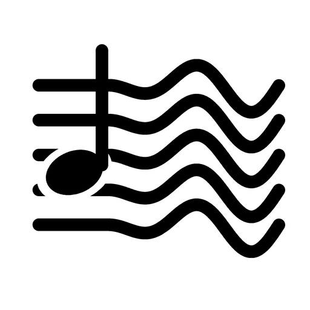

  

<h1 align="center">Pauta Viva</h1>

  A música que você quer aprender, em partitura, cifra, letra e tablatura, andando junto com o som. 
  Ferramenta 100% didática. Roda no seu computador.

---

## O que é

Você escolhe uma gravação (MP3, WAV, M4A, FLAC ou OGG) e o Pauta Viva:

- **separa** a música em voz, violão, teclado, cavaco, baixo e percussão;
- **acha** o andamento, o compasso, o tom e os acordes (cifra no padrão brasileiro);
- **escreve** a melodia na pauta, com a letra sílaba por sílaba embaixo das notas;
- **transcreve o violão** nota por nota, com tablatura e as posições no braço;
- **toca tudo junto**: o cursor anda na partitura no tempo do som, com mesa de som (volume, equalizador e
  pan de cada instrumento), velocidade reduzida, repetição de trecho e metrônomo;
- **Modo palco** (acorde gigante para tocar junto) e **Modo Show** (partitura numa esteira, com a foto do
  artista no fundo e pontos tocando no microfone).

Tudo é processado no seu computador. A internet só é usada para instalar, baixar os modelos na primeira vez
e buscar a letra e a capa de cada música.

## Instalar

1. Baixe o instalador `PautaViva-Setup-<versão>.exe` na página de **Releases** deste repositório.
2. Abra e siga as telas (não precisa de administrador). O instalador baixa o Python e os componentes de
   inteligência artificial: de 1,5 a 4 GB, de 10 a 40 minutos, conforme a internet e o computador.
3. Abra o **Pauta Viva** pelo atalho na área de trabalho ou no menu Iniciar.

Sem o instalador: baixe o código (Code → Download ZIP), extraia numa pasta de caminho curto
(por exemplo `C:\PautaViva`) e abra o `iniciar.bat`.

## Requisitos

| | Mínimo | Recomendado |
| --- | --- | --- |
| Sistema | Windows 10 ou 11, 64 bits | Windows 11 |
| Processador | 4 núcleos (Intel Core i5 de 3ª geração, AMD Ryzen 3) | 6 núcleos ou mais |
| Memória | 8 GB | 16 GB |
| Disco livre | 10 GB | 15 GB (com placa NVIDIA) |
| Placa de vídeo | não precisa | NVIDIA com 6 GB ou mais (GTX 1660, RTX 2060 ou superior) |
| Navegador | Chrome ou Edge atualizado | |

Com placa NVIDIA, cada música fica pronta em 1 a 2 minutos, com a separação máxima dos instrumentos e o
reconhecimento de letra mais preciso. Sem ela, leva de 3 a 4 vezes a duração da música.

## Para quem desenvolve

| Pasta | O que tem |
| --- | --- |
| `app/` | servidor local (FastAPI) e a análise: separação, ritmo, tom, acordes, melodia, violão, letra, partitura |
| `web/` | a interface (HTML, CSS e JavaScript, sem etapa de build) |
| `instalador/` | instalador do Windows (Inno Setup) e o gerador das imagens e textos dele |
| `tools/` | prova das cifras contra um gabarito |
| `PROJETO.md` | visão, decisões, aprendizados e próximos passos |

Rodar em desenvolvimento: `iniciar.bat` (cria o ambiente na primeira vez e abre em http://127.0.0.1:8765).

Gerar o instalador: `.venv\Scripts\python.exe instalador\gerar.py` e depois
`"%LOCALAPPDATA%\Programs\Inno Setup 6\ISCC.exe" instalador\PautaViva.iss` (sai em `dist\`).

## Uso e responsabilidade

O Pauta Viva é feito exclusivamente para estudo. As obras, as gravações, as letras e as capas pertencem aos
seus titulares; o material gerado é para uso pessoal, e a sua divulgação sem autorização é proibida.
Veja o termo completo no instalador (`instalador/gerar.py`, seção TERMO) e os créditos em
[THIRD_PARTY_NOTICES.md](THIRD_PARTY_NOTICES.md).

Versão de teste. © 2026. Todos os direitos reservados (veja [LICENSE](LICENSE)).
